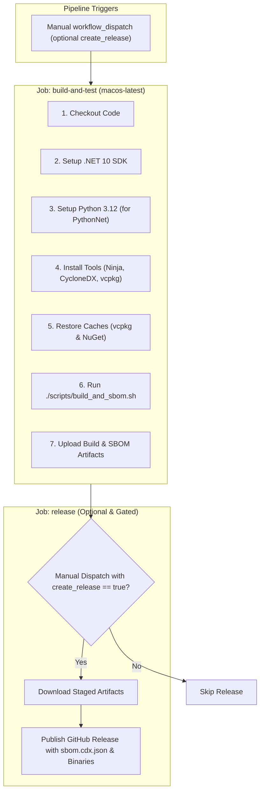

# Specification: GITHUB-CI (lite-sdd/GITHUB-CI/SPEC.md)

## 1. Overview & Goals

The `GITHUB-CI` specification defines a lightweight, efficient, and reproducible GitHub Actions Continuous Integration (CI) and optional release pipeline for the `MiniLayout` project in its private repository.

### Goals
- **Manual-Only Triggering**: Execute CI builds on-demand exclusively via `workflow_dispatch` (with optional `create_release` boolean input) to prevent unnecessary macOS ARM64 runner consumption during routine commits, documentation updates, and cleanup.
- **Single Source of Truth**: Leverage the existing `scripts/build_and_sbom.sh` script to build the C++20 native engine (vcpkg manifest mode with `glm` and `spdlog`), compile the .NET 10 solution, run headless `xUnit` test suites, and generate the CycloneDX SBOM (`sbom.cdx.json`).
- **Practical Runtimes via Caching**: Implement caching for vcpkg binary artifacts and NuGet packages to avoid redundant compilation and package restoration.
- **Artifact Management**: Archive build outputs (`libnative_engine.dylib`, `MiniLayout.App`, `sbom.cdx.json`) on every CI run.
- **Isolated / Gated Release Step**: Provide an optional, gated release job triggered via manual `workflow_dispatch` with `create_release: true` for internal testing in the private repository, designed to be cleanly omitted or detached when publishing to a public repository.
- **Headless Execution**: Ensure all test runs and build steps are strictly non-interactive and headless with zero display server dependencies.
- **Zero Impact on Base Spec**: Do not modify `lite-sdd/base/` or any existing base specifications.

---

## 2. Target Environment & Stack

| Component | Choice | Rationale |
|---|---|---|
| **CI Runner** | `macos-latest` (ARM64) | Matches the target architecture (Apple Silicon ARM64) for building and testing the native dynamic library (`libnative_engine.dylib`) and .NET 10 ARM64 binaries. |
| **Workflow File** | `.github/workflows/ci.yml` | Standard GitHub Actions workflow definition path. |
| **Native Toolchain** | Xcode / Apple Clang (C++20), CMake, Ninja | Standard macOS build system supported by `scripts/build_and_sbom.sh`. |
| **Package Managers** | `vcpkg` (manifest mode) + NuGet | Native C++ dependencies (`glm`, `spdlog`) and managed packages (`Avalonia`, `pythonnet`, `xunit`). |
| **Managed Runtime** | .NET 10 SDK (`net10.0`) | Configured via `actions/setup-dotnet@v4` honoring `global.json`. |
| **Embedded Python** | Python 3.12 / 3.13 (`actions/setup-python@v5`) | Supported PythonNet ABI for dynamic runtime discovery on the runner. |
| **SBOM Generation** | `dotnet-CycloneDX` + `scripts/build_and_sbom.sh` | Generates standard CycloneDX 1.7 JSON SBOM (`sbom.cdx.json`). |
| **Caching Actions** | `actions/cache@v4` | Caches vcpkg binary archives (`~/.cache/vcpkg`) and NuGet packages (`~/.nuget/packages`). |
| **Artifact / Release** | `actions/upload-artifact@v4` & `softprops/action-gh-release@v2` | Uploads pipeline artifacts and publishes optional GitHub releases. |

---

## 3. Workflow Architecture & Pipeline Flow

---

## 4. Functional Requirements

### 4.1 Triggers & Concurrency
1. **Trigger Events**:
   - `workflow_dispatch`: Manual execution only from GitHub Actions UI or `gh workflow run`, with optional boolean input `create_release` (default: `false`). Automatic `push` and `pull_request` triggers are omitted to conserve macOS ARM64 runner minutes.
2. **Concurrency**:
   - Cancel in-progress runs for the same branch/ref using `concurrency: group: ${{ github.workflow }}-${{ github.ref }}, cancel-in-progress: true`.

### 4.2 Job 1: `build-and-test`
1. **Runner**: Runs on `macos-latest`.
2. **Steps**:
   - **Checkout**: `actions/checkout@v4`.
   - **.NET Setup**: `actions/setup-dotnet@v4` reading `global.json` (or targeting `10.0.x`).
   - **Python Setup**: `actions/setup-python@v5` with version `3.12` to provide a guaranteed PythonNet-compatible shared library on the runner.
   - **Tool Installation**:
     - Ensure `ninja` is installed (`brew install ninja` if not pre-installed).
     - Install `dotnet-CycloneDX` global tool (`dotnet tool install --global CycloneDX`).
     - Bootstrap/locate `vcpkg` (use runner's built-in `$VCPKG_INSTALLATION_ROOT` or clone/bootstrap `~/tools/vcpkg`).
   - **Caching**:
     - **vcpkg Cache**: Cache directory `~/.cache/vcpkg` keyed by OS and `src/native-engine/vcpkg.json` hash:
       `key: ${{ runner.os }}-vcpkg-${{ hashFiles('src/native-engine/vcpkg.json') }}`.
     - **NuGet Cache**: Cache directory `~/.nuget/packages` keyed by OS and solution/csproj files:
       `key: ${{ runner.os }}-nuget-${{ hashFiles('**/*.csproj', 'global.json') }}`.
   - **Execution**:
     - Run `chmod +x scripts/build_and_sbom.sh && ./scripts/build_and_sbom.sh`.
     - Validates that:
       1. Native engine compiles cleanly into `libnative_engine.dylib`.
       2. .NET solution builds in Release mode with 0 errors.
       3. All 6 headless xUnit tests pass.
       4. `sbom.cdx.json` is generated with both NuGet and vcpkg components.
   - **Artifact Upload**:
     - Upload `sbom.cdx.json`.
     - Upload compiled `MiniLayout.App` Release binaries and `libnative_engine.dylib` under artifact name `minilayout-macos-arm64`.

### 4.3 Job 2: `release` (Optional / Gated)
1. **Dependencies**: `needs: build-and-test`.
2. **Gating Condition**:
   - Executes only when:
     `github.event_name == 'workflow_dispatch' && inputs.create_release == true`
3. **Execution**:
   - Downloads build artifacts from `build-and-test`.
   - Packages binaries into a compressed archive (`MiniLayout-macos-arm64.tar.gz`).
   - Creates a GitHub Release (via `softprops/action-gh-release@v2` or `gh release create`) containing:
     - `MiniLayout-macos-arm64.tar.gz`
     - `sbom.cdx.json`
4. **Isolation / Portability**:
   - The release job is self-contained as a second job in `ci.yml`. When publishing the repository publicly, this job block can be deleted or commented out without altering the primary `build-and-test` verification job.

---

## 5. Constraints & Non-Goals

1. **Strictly Headless**:
   - Avalonia GUI window launches (`dotnet run --project src/MiniLayout.App`) must **not** be executed in the CI workflow. Testing is performed exclusively via `tests/MiniLayout.Tests` (`dotnet test`).
2. **Isolation from Base Specs**:
   - No modifications to files in `lite-sdd/base/` or root `SPEC.md` / `PLAN.md`.
3. **Reproducibility**:
   - The CI runner executes the exact same script (`scripts/build_and_sbom.sh`) used for local development, preventing drift between developer machines and CI.
4. **Phased SDD Compliance**:
   - Phase 1 creates ONLY `lite-sdd/GITHUB-CI/SPEC.md`. Implementation plan (`PLAN.md`) and workflow YAML files are deferred until approval.
