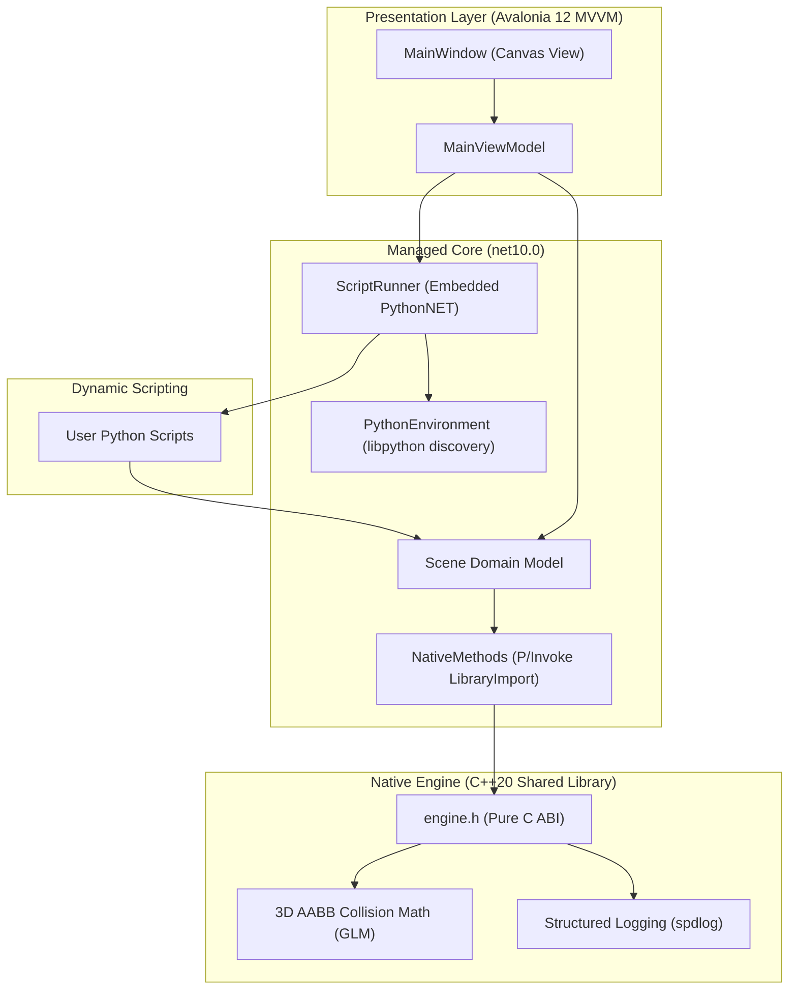
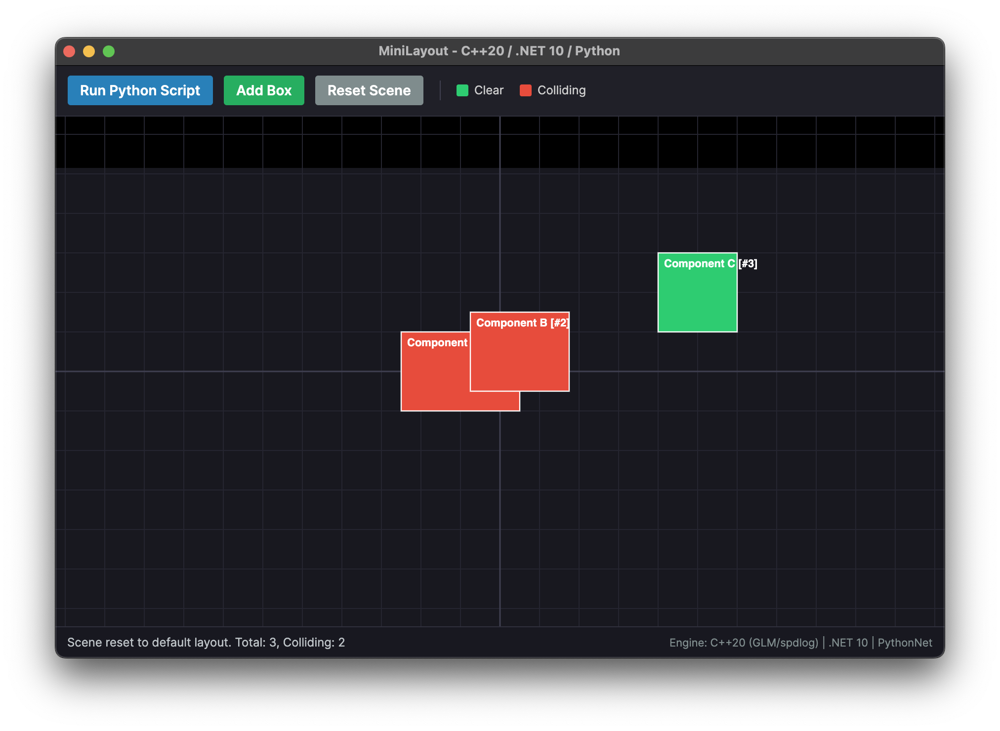

# MiniLayout

A compact, cohesive polyglot reference desktop application built for **macOS (Apple Silicon M4 / ARM64)**, showcasing modern cross-language architecture:
- **Performance Layer**: C++20 shared library implementing 3D Axis-Aligned Bounding Box (AABB) collision detection with `glm` and structured logging with `spdlog` (managed via `vcpkg` manifest mode).
- **Domain & Scripting**: .NET 10 (`net10.0`) class library featuring source-generated `[LibraryImport]` P/Invoke bindings, custom `DllImportResolver`, clean `Scene` domain model, and embedded Python (`pythonnet`) with automatic `libpython` discovery.
- **Presentation**: Avalonia UI 12 (`net10.0` MVVM) with a top-down 2D canvas displaying colliding (Red) and clear (Green) components, plus interactive Python layout script triggers.
- **Verification**: Headless `xUnit` test suite testing collision math and Python scene mutations without requiring a window manager or display server.
- **Supply Chain**: Unified build script (`scripts/build_and_sbom.sh`) compiling native C++ and .NET, running test suites, and generating a unified CycloneDX SBOM (`sbom.cdx.json`).

---

## Architecture Overview



---

## Technical Design & Architectural Decisions

### 1. Cross-Platform C ABI & P/Invoke
- **Strict C ABI (`extern "C"`)**: The native engine exports functions using standard C linkage to avoid C++ name mangling and compiler ABI variations:
  - `engine_check_pair_collision(const NativeBox* a, const NativeBox* b)`
  - `engine_evaluate_scene(const NativeBox* boxes, int32_t count, int32_t* out_collision_flags)`
- **Blittable Memory Layout**: `NativeBox` is declared as sequential fixed-size fields (`int32_t id`, `float x, y, z, width, height, depth`), identical in memory between C++ and C# `[StructLayout(LayoutKind.Sequential)]`.
- **Zero-Overhead P/Invoke**: C# uses source-generated `[LibraryImport("native_engine")]` from .NET 7+, eliminating runtime IL generation and runtime marshaling overhead.
- **Custom `DllImportResolver`**: Dynamically discovers `libnative_engine.dylib` on macOS (or `native_engine.dll` on Windows) whether executing from development bin directories or application installation roots.

### 2. Embedded Python Scripting (`pythonnet`)
- **Dynamic `libpython` Discovery**: `PythonEnvironment` automatically locates the installed Python dynamic shared library across standard locations on macOS (Homebrew `/opt/homebrew/opt/python@*/Frameworks/Python.framework/Versions/*/Python`, Xcode CLI tools Python 3.9, or custom `PYTHONNET_PYDLL` overrides).
- **Thread-Safe Execution**: Every script invocation is executed under a Python Global Interpreter Lock scope (`using (Py.GIL())`) using isolated PyScopes.
- **Bidirectional Interop**: C# passes the live `Scene` instance directly to the Python scope, allowing user scripts to query, add, translate, and evaluate layout components dynamically.

### 3. Supply Chain Security (CycloneDX SBOM)
- The build pipeline utilizes `dotnet-CycloneDX` to inspect all direct and transitive NuGet dependencies and generates a standard CycloneDX JSON SBOM (`sbom.cdx.json`).
- Native dependencies resolved via `vcpkg` manifest mode (`glm`, `spdlog`, `fmt`) are parsed from vcpkg install manifests and merged into `sbom.cdx.json` under `pkg:vcpkg/` Package URLs (PURLs).

---

## Repository Layout

```text
minilayout/
├── README.md                         # Architecture and developer documentation
├── MiniLayout.sln                    # Unified .NET solution
├── global.json                       # .NET SDK version pin
├── docs/
│   └── screenshot.png                # Desktop UI screenshot
├── lite-sdd/
│   ├── BASE/
│   │   ├── SPEC.md                   # Base application specification
│   │   └── PLAN.md                   # Base application implementation plan
│   └── GITHUB-CI/
│       ├── SPEC.md                   # GitHub Actions CI specification
│       └── PLAN.md                   # GitHub Actions CI implementation plan
├── .github/
│   └── workflows/
│       └── ci.yml                    # Manual workflow_dispatch CI (and gated release job)
├── scripts/
│   └── build_and_sbom.sh             # End-to-end build, test, and SBOM script
├── src/
│   ├── native-engine/                # Native C++20 engine
│   │   ├── CMakeLists.txt            # CMake configuration with vcpkg integration
│   │   ├── vcpkg.json                # vcpkg manifest (glm, spdlog)
│   │   ├── include/
│   │   │   └── engine.h              # Pure C ABI header
│   │   └── src/
│   │       └── engine.cpp            # 3D AABB overlap logic and spdlog output
│   ├── MiniLayout.Core/              # .NET 10 class library
│   │   ├── Native/                   # NativeTypes and [LibraryImport] bindings
│   │   ├── Models/                   # BoundingBox3D, LayoutComponent, Scene
│   │   └── Scripting/                # PythonEnvironment and ScriptRunner
│   └── MiniLayout.App/               # Avalonia 12 desktop UI application
│       ├── ViewModels/               # ViewModelBase, MainViewModel
│       └── Views/                    # LayoutCanvas (2D projection), MainWindow
└── tests/
    └── MiniLayout.Tests/             # Headless xUnit tests
        ├── CollisionTests.cs         # C++ AABB collision verification
        └── ScriptingTests.cs         # PythonNet runtime and script execution tests
```

---

## Prerequisites

On macOS ARM64 (Apple Silicon):

```bash
# 1. Xcode Command Line Tools
xcode-select --install

# 2. Homebrew packages (CMake, Ninja, vcpkg)
brew install cmake ninja
git clone [https://github.com/microsoft/vcpkg.git](https://github.com/microsoft/vcpkg.git) ~/tools/vcpkg
~/tools/vcpkg/bootstrap-vcpkg.sh -disableMetrics
export VCPKG_ROOT="$HOME/tools/vcpkg"

# 3. .NET 10 SDK & CycloneDX tool
brew install --cask dotnet-sdk
dotnet tool install --global CycloneDX
```

---

## Build, Test, and SBOM

### Automated Pipeline (Recommended)

Run the unified automation script:

```bash
chmod +x scripts/build_and_sbom.sh
./scripts/build_and_sbom.sh
```

This single command will:
1. Verify all build prerequisites (`cmake`, `ninja`, `clang++`, `dotnet`, `vcpkg`, `dotnet-CycloneDX`).
2. Build the C++20 native shared library (`libnative_engine.dylib`) via CMake and Ninja.
3. Deploy the native library to .NET application and test output directories.
4. Build the complete .NET 10 solution in Release mode.
5. Execute headless xUnit tests validating C++ collision math and embedded Python scripting.
6. Generate and enrich the complete CycloneDX SBOM (`sbom.cdx.json`).

### Running the Desktop Application

From source:

```bash
dotnet run --project src/MiniLayout.App
```

If running from an extracted release archive on macOS where the native `MiniLayout.App` apphost binary is blocked (`killed`) by macOS code-signing checks, run the managed assembly directly with the .NET 10 SDK from the extracted folder:

```bash
dotnet ./MiniLayout.App.dll
```



- **Top-Down 2D Canvas**: Visualizes layout components on a centered grid with coordinate axes.
- **Dynamic Collision Feedback**:
  - **Green (`#2ecc71`)**: Clear component.
  - **Red (`#e74c3c`)**: Active collision detected by native C++ engine.
- **Controls**:
  - **Run Python Script**: Executes an embedded script rearranging components to trigger and resolve collisions.
  - **Add Box**: Dynamically appends a new layout entity to the scene.
  - **Reset Scene**: Restores initial sample layout.

### Running Headless Tests

```bash
dotnet test tests/MiniLayout.Tests/MiniLayout.Tests.csproj
```

---

## Continuous Integration & Releases (GitHub Actions)

The repository provides an automated CI and optional release workflow defined in [`.github/workflows/ci.yml`](.github/workflows/ci.yml).

### 1. Manual Workflow Execution (`workflow_dispatch`)
To avoid unnecessary consumption of macOS ARM64 runner minutes during routine local development and documentation updates, CI builds are triggered manually:
- Run via GitHub Web UI under the **Actions** tab -> **CI** -> **Run workflow**.
- Or trigger via GitHub CLI:
  ```bash
  gh workflow run ci.yml
  ```

### 2. Jobs Overview
- **`build-and-test`**:
  - Sets up .NET 10, Python 3.12, Ninja, and vcpkg.
  - Caches vcpkg binary artifacts (`~/.cache/vcpkg`) and NuGet packages (`~/.nuget/packages`).
  - Executes [`scripts/build_and_sbom.sh`](scripts/build_and_sbom.sh) directly to ensure exact parity with local builds.
  - Archives `cyclonedx-sbom` (`sbom.cdx.json`) and `minilayout-macos-arm64` application binaries as workflow artifacts.
- **`release` (Gated & Optional)**:
  - Depends on `build-and-test`.
  - Gated by `create_release: true` parameter:
    ```bash
    gh workflow run ci.yml -f create_release=true
    ```
  - Bundles the application binaries into `MiniLayout-macos-arm64.tar.gz` and publishes a GitHub Release containing both the archive and `sbom.cdx.json`.

### 3. Detaching / Omitting Release for Public Repository
The `release` job is completely isolated and self-contained at the bottom of `.github/workflows/ci.yml`. When publishing this project to a public repository without private release tooling:
- Simply remove or comment out the `release:` job block.
- The `build-and-test` job can then be run manually via `workflow_dispatch` whenever needed to validate builds, tests, and SBOM generation.